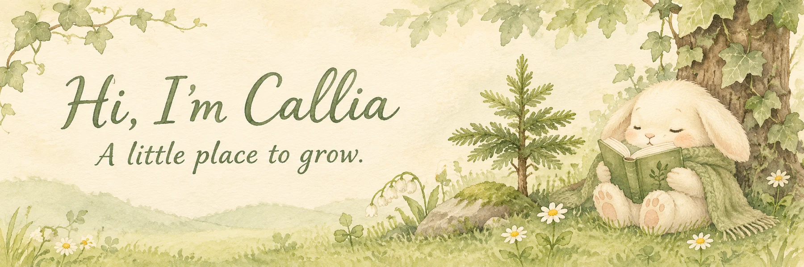

  

  <em>There are few evergreen trees in the passage of time.</em>

  在代码与好奇心里，慢慢种下一些常青的东西。 
  记录一些想法，也把有用的小工具分享出来。

 

## 🌿 一点关于我 · About

你好，我是 **Callia**。这里收藏了我的一些项目与实验：从聊天机器人、自动化，到 iOS 工具和云端服务。

喜欢把想法慢慢做成可以使用的小工具，也愿意在探索中不断学习。

  
  
  
  

## 🍃 精选项目 · Selected projects

**[常青藤 · TGChatBot-Callia](https://github.com/Callia218/TGChatBot-Callia)**  
基于 TGChatBot 改造的 Telegram 双向客服机器人，使用 Cloudflare Workers、D1 和 Mini App 验证。

**[LCSignClone](https://github.com/Callia218/LCSignClone)**  
基于 SwiftUI 与 zsign 的 iOS 重签名工具项目，探索设备本地签名和证书管理。

**[wechat-auto-bot](https://github.com/Callia218/wechat-auto-bot)**  
基于 LangGraph 和 wxauto 的微信自动回复机器人，支持会话上下文与消息自动化。

<a href="https://github.com/Callia218?tab=repositories">看看更多项目 →</a>

## 🌱 小小记录 · GitHub snapshot

  

公开数据每天自动更新 · 由 GitHub Actions 生成

 

  <em>Thanks for stopping by. Take your time and stay a while.</em> 
  愿热爱常青，愿每一个小小的想法都有生长的空间。

