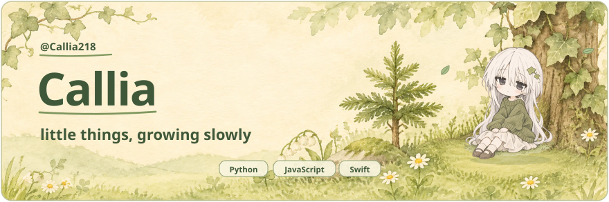

  <picture>
    <source media="(prefers-reduced-motion: reduce)" srcset="assets/evergreen-animated.svg#still">
    
  </picture>

  <picture>
    <source media="(max-width: 650px)" srcset="assets/about-note-mobile.svg">
    
  </picture>
   
   
  
   

## GitHub snapshot

  <picture>
    <source media="(max-width: 650px)" srcset="assets/github-snapshot-mobile.svg">
    
  </picture>

## Selected projects

- [**常青藤 · TGChatBot-Callia**](https://github.com/Callia218/TGChatBot-Callia) · Telegram 双向客服机器人，使用 Cloudflare Workers、D1 和 Mini App 验证。
- [**LCSignClone**](https://github.com/Callia218/LCSignClone) · 基于 SwiftUI 和 zsign 的 iOS 重签名工具项目。
- [**wechat-auto-bot**](https://github.com/Callia218/wechat-auto-bot) · 基于 LangGraph 和 wxauto 的微信自动回复机器人。

There are few evergreen trees in the passage of time. 🌿

